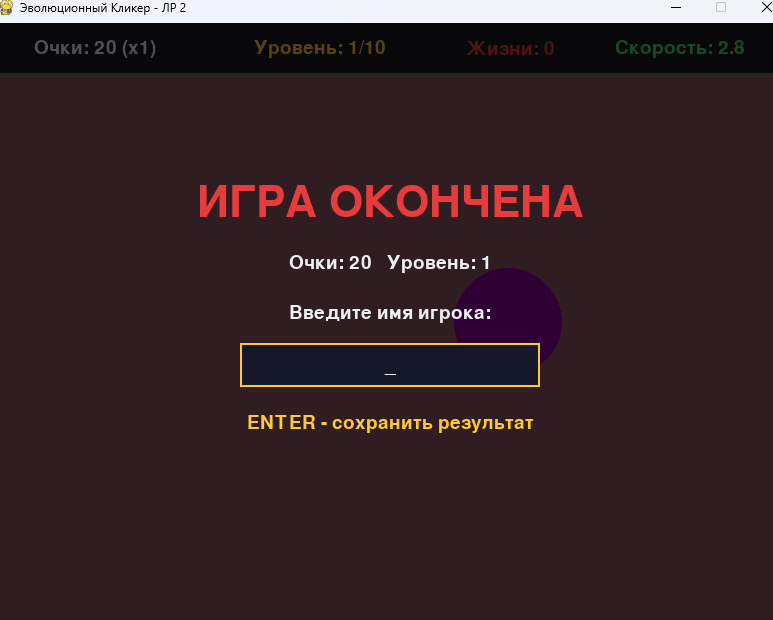

# Chameleon Clicker

## «Эволюционный Кликер»

Лабораторные работы № 1–2 по курсу «Современные языки программирования», вариант 8.
Выполнил: Демко А.В., группа 25-СТ.

| Лабораторная | Тема | Что реализовано |
|--------------|------|-----------------|
| **ЛР 1** | Алгоритмизация на Python (вариант 8: Эволюционный Кликер) | Игра на Pygame: кнопка-мишень, попадание по формуле расстояния, уменьшение радиуса на 5%, сближение цветов, меню, HUD, экраны завершения |
| **ЛР 2** | Управление файлами и представление данных | Настройки в JSON с валидацией, лог событий, профили игроков в CSV, топ-3 на старте, ввод имени, множитель клика |

Chameleon Clicker — это 2D аркадный кликер на Pygame. По экрану движется кнопка-мишень. С каждым попаданием она уменьшается, ускоряется и «мимикрирует»: цвет кнопки всё сильнее сливается с цветом фона.

Игрок кликает по кнопке мышью. Промах отнимает жизнь. Нужно дойти до 10 уровня. После игры вводится имя, и прогресс сохраняется в таблицу профилей `clicker_profiles.csv`. Топ-3 игроков показывается на стартовом экране.

* * *

## Стек технологий

- **Python 3.9+** (проверено на 3.12)
- **Pygame** — графика, обработка ввода, игровой цикл
- Стандартная библиотека: `json`, `csv`, `logging`, `pathlib`, `os`, `datetime`

* * *

## Структура проекта

```
chameleon_clicker/
├── main.py                     # ЛР1: точка входа в приложение
├── requirements.txt            # ЛР1: зависимости (pygame)
├── README.md                   # ЛР1+ЛР2: описание проекта и файлов данных
├── screenshots/                # ЛР1+ЛР2: скриншоты для README
└── py_chameleon_clicker/
    ├── constants.py            # ЛР1: константы окна и цветов; ЛР2: пути к файлам, значения по умолчанию
    ├── game.py                 # ЛР1: игровой цикл и состояния; ЛР2: ввод имени, множитель, вызовы data_io
    ├── button.py               # ЛР1: класс TargetButton (кнопка-мишень)
    ├── color_utils.py          # ЛР1: алгоритм сближения цветов (без pygame)
    ├── ui.py                   # ЛР1: меню, HUD, экраны завершения; ЛР2: топ-3, окно ввода имени
    ├── data_io.py              # ЛР2: работа с файлами (настройки, лог, профили)
    ├── clicker_config.json     # ЛР2: настройки игры (JSON)
    ├── game.log                # ЛР2: лог событий с timestamp (создаётся при запуске)
    └── clicker_profiles.csv    # ЛР2: профили игроков (создаётся при первом сохранении)
```

### Назначение модулей

| Модуль           | Назначение                                                                           |
|------------------|--------------------------------------------------------------------------------------|
| `main.py`        | Создаёт `Game` и запускает цикл (`if __name__ == "__main__"`)                        |
| `constants.py`   | Параметры окна, цвета, пути к файлам (`pathlib`), значения настроек по умолчанию     |
| `game.py`        | Игровой цикл, клики, уровни, жизни, множитель, ввод имени, смена состояний           |
| `button.py`      | Кнопка: движение, отскок, телепорт, уменьшение, проверка попадания                   |
| `color_utils.py` | Генерация пары «фон — кнопка» с уменьшающейся разницей                               |
| `ui.py`          | Стартовый экран с топ-3, панель HUD, окно ввода имени, экран завершения              |
| `data_io.py`     | Загрузка `clicker_config.json`, логирование в `game.log`, запись `clicker_profiles.csv` |

* * *

## Запуск игры

Из папки проекта:

```
pip install -r requirements.txt
python main.py
```

* * *

## Управление

| Клавиша / действие        | Назначение                                 |
|---------------------------|--------------------------------------------|
| `ЛКМ`                     | Клик по кнопке-мишени                      |
| `Enter` / `Пробел` / клик | Начать игру (на стартовом экране)          |
| Буквы, `Backspace`        | Ввод имени после окончания игры            |
| `Enter`                   | Сохранить результат в CSV                  |
| `R`                       | Играть заново (после сохранения результата)|
| `Esc` или закрыть окно    | Выход из игры                              |

* * *

## Механики игры

### 1. Кнопка-мишень (ЛР 1)

Кнопка описывается структурой `(x, y, radius, color)` и скоростью движения.
Она летит по экрану и отскакивает от границ игровой зоны.

### 2. Попадание, промах и множитель клика (ЛР 1; множитель — ЛР 2)

- Попадание проверяется по формуле расстояния: `math.hypot(px - x, py - y) <= radius`.
- При попадании: кнопка телепортируется, радиус уменьшается на 5%, скорость растёт.
- Очки за попадание: `points_per_hit × уровень × множитель`.
- **Множитель клика**: каждые 3 попадания подряд (`combo_step`) добавляют +1 к множителю, максимум x5. Промах сбрасывает серию и множитель до x1.
- Промах мимо кнопки отнимает одну жизнь. Клики по панели HUD игнорируются.

### 3. Алгоритм сближения цветов (ЛР 1)

1. Цвет фона — случайный `(R, G, B)`.
2. Цвет кнопки — цвет фона, в котором каждый канал сдвинут на случайное число из `[-max_diff, +max_diff]` и ограничен диапазоном 0..255.
3. Максимальная разница зависит от уровня: `max_diff = max(15, 200 - (level - 1) * 20)`.

| Уровень | Макс. разница каналов |
|---------|-----------------------|
| 1       | 200                   |
| 5       | 120                   |
| 10      | 20                    |

### 4. Условия победы и поражения (ЛР 1)

| Исход         | Условие                                       |
|---------------|-----------------------------------------------|
| **Победа**    | Игрок достиг 10 уровня (50 попаданий)         |
| **Поражение** | Жизни закончились (3 промаха)                 |

* * *

## Интерфейс

### Стартовый экран (ЛР 1; топ-3 — ЛР 2)

- Заголовок, правила игры
- **ТОП-3 ИГРОКОВ** из `clicker_profiles.csv` (имя, очки, уровень, множитель)
- Подсказка «ENTER / клик — начать»

### Игровой экран

- Фон случайного цвета и кнопка-мишень
- Панель HUD: очки (и множитель), уровень, жизни, скорость кнопки

### Ввод имени (ЛР 2)

- После победы или поражения появляется поле для имени игрока (до 12 символов)
- Пустое имя заменяется на «Игрок», имя прошлой игры подставляется автоматически

### Экран завершения

- `ПОБЕДА!` (зелёный) или `ИГРА ОКОНЧЕНА` (красный)
- Очки, уровень, максимальный множитель и сообщение о сохранении профиля

* * *

## Файлы данных (ЛР 2)

### clicker_config.json

Настройки игры. Загружаются при старте. Все параметры можно менять без правки кода.

```json
{
  "start_lives": 3,
  "hits_per_level": 5,
  "max_level": 10,
  "button_start_radius": 60,
  "button_min_radius": 8,
  "button_shrink_factor": 0.95,
  "button_start_speed": 2.0,
  "button_speed_step": 0.4,
  "color_diff_start": 200,
  "color_diff_min": 15,
  "color_diff_step": 20,
  "points_per_hit": 10,
  "combo_step": 3,
  "max_multiplier": 5
}
```

**Валидация** (`data_io.load_config`):

| Ситуация                                  | Поведение                                              |
|-------------------------------------------|--------------------------------------------------------|
| Файл отсутствует (`FileNotFoundError`)    | Используются значения по умолчанию из `constants.py`   |
| Повреждён JSON (`JSONDecodeError`)        | Значения по умолчанию, ошибка в консоль и в лог        |
| Параметр неверного типа или вне диапазона | Для него берётся значение по умолчанию, остальные — из файла |
| Неизвестный ключ                          | Игнорируется, предупреждение в лог                     |
| Радиусы или цветовые границы противоречат друг другу | Сбрасываются на значения по умолчанию       |

### game.log

Лог-файл «чёрный ящик». Каждая строка: время, уровень сообщения, описание. Записываются события:

- запуск и закрытие игры, начало новой игры
- загрузка настроек и ошибки в файле настроек
- каждое попадание и промах
- повышение уровня, победа или поражение
- сохранение профиля игрока

Пример:

```
2026-10-28 01:18:08 | INFO | Игра запущена
2026-10-28 01:18:10 | INFO | Новая игра началась
2026-10-28 01:18:12 | INFO | Попадание. Очки: 10, множитель x1
2026-10-28 01:18:14 | WARNING | Промах. Осталось жизней: 2
2026-10-28 01:19:05 | INFO | Поражение. Очки: 420, уровень: 4
2026-10-28 01:19:09 | INFO | Профиль «Артём» создан: уровень 4, очки 420, множитель x3
```

### clicker_profiles.csv

Таблица профилей игроков. Поля: `Имя`, `Уровень`, `Очки`, `Множитель`, `Дата`.

```
Имя,Уровень,Очки,Множитель,Дата
Артём,4,420,3,2026-10-28 01:19
Мария,6,980,4,2026-10-28 01:25
```

- Файл создаётся автоматически при первом сохранении, вместе со строкой заголовков.
- Если игрок с таким именем уже есть (без учёта регистра), его строка **обновляется** (уровень, очки, множитель и дата последней игры), иначе добавляется новая.
- Запись идёт через временный файл и `os.replace`: если программа аварийно завершится, старая таблица не потеряется.
- Кодировка `utf-8-sig`, чтобы русские имена правильно открывались в Excel.
- Повреждённые строки при чтении пропускаются и попадают в лог.
- Если файл открыт в Excel и недоступен для записи, игра не падает, а выводит сообщение «Не удалось сохранить результат».

**Почему JSON и CSV:** JSON подходит для настроек, потому что хранит типы значений (числа, строки) и легко расширяется. CSV подходит для таблицы однотипных записей, и его можно открыть в Excel.

* * *

## Конфигурация

Значения по умолчанию задаются в `constants.py` (`DEFAULT_CONFIG`), а рабочие значения читаются из `clicker_config.json`. Пути к файлам заданы через `pathlib`:

```python
DATA_DIR = Path(__file__).resolve().parent
CONFIG_FILE = DATA_DIR / "clicker_config.json"
LOG_FILE = DATA_DIR / "game.log"
PROFILES_FILE = DATA_DIR / "clicker_profiles.csv"
```

* * *

## Скриншоты

### Стартовый экран с топ-3 (ЛР 2)


Правила игры и таблица лучших игроков из CSV.

### Игровой процесс, начало (ЛР 1)


Кнопка хорошо видна на фоне.

### Игровой процесс, 4 уровень (ЛР 1)


Кнопка меньше и быстрее, цвета фона и кнопки сближаются.

### Ввод имени игрока (ЛР 2)



После окончания игры вводится имя для сохранения результата.

### Экран завершения (ЛР 1)


Итоговые очки, множитель и сообщение о сохранении профиля.

* * *

## Зависимости

Убедитесь, что установлен Python и Pygame:

```
python -c "import pygame; print(pygame.__version__)"
```

Если Pygame не установлен:

```
pip install pygame
```
