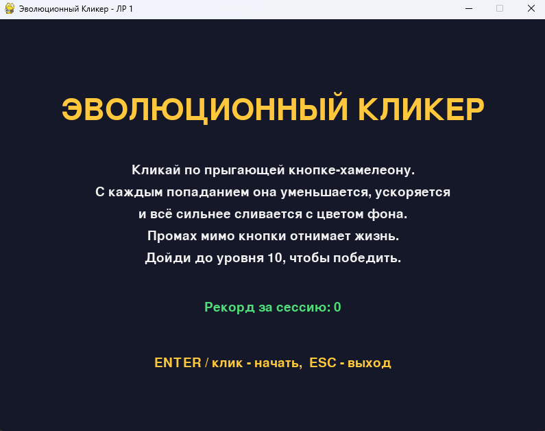
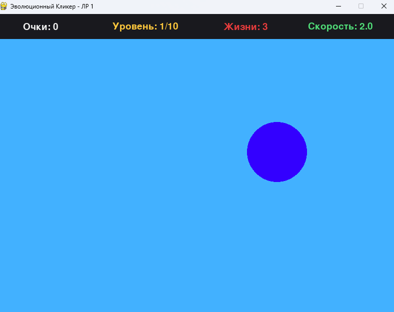
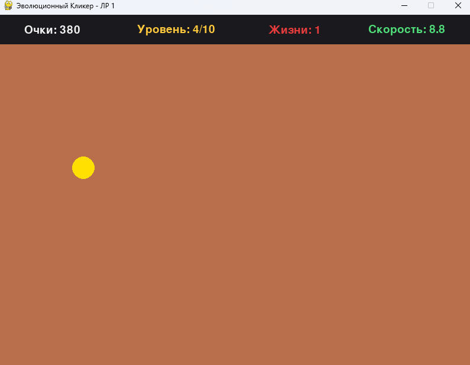
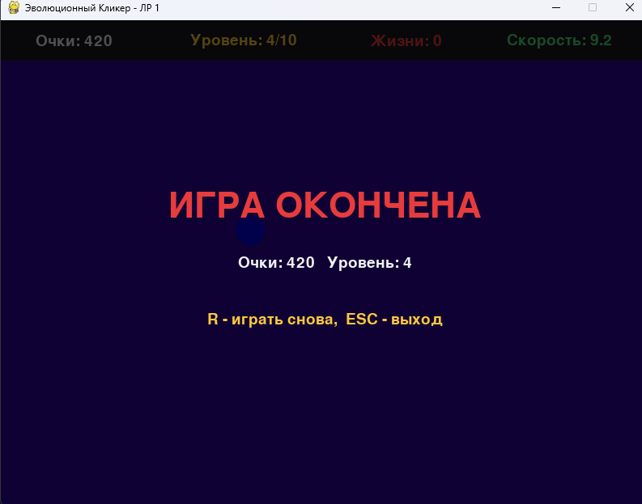

# Chameleon Clicker

## «Эволюционный Кликер»

Лабораторная работа № 1 «Алгоритмизация на языке Python», вариант 8.
Выполнил: Демко А.В., группа 25-СТ.

Chameleon Clicker — это 2D аркадный кликер на Pygame. По экрану движется кнопка-мишень. С каждым попаданием она уменьшается, ускоряется и «мимикрирует»: цвет кнопки всё сильнее сливается с цветом фона.

Игрок должен кликать по кнопке мышью. Промах отнимает жизнь. Нужно дойти до 10 уровня.

* * *

## Стек технологий

- **Python 3.9+** (проверено на 3.12)
- **Pygame** — графика, обработка ввода, игровой цикл

* * *

## Структура проекта

```
chameleon_clicker/
├── main.py                  # Точка входа в приложение
├── requirements.txt         # Зависимости (pygame)
├── README.md                # Описание проекта
├── screenshots/             # Скриншоты для README
└── py_chameleon_clicker/
    ├── __init__.py          # Документация пакета
    ├── constants.py         # Все константы: окно, цвета, параметры механик, состояния
    ├── game.py              # Класс Game: игровой цикл, события, состояния
    ├── button.py            # Класс TargetButton: кнопка-мишень
    ├── color_utils.py       # Алгоритм сближения цветов (без pygame)
    └── ui.py                # Интерфейс: меню, HUD, экраны победы и поражения
```

### Назначение модулей

| Модуль           | Назначение                                                              |
|------------------|-------------------------------------------------------------------------|
| `main.py`        | Создаёт `Game` и запускает цикл (`if __name__ == "__main__"`)           |
| `constants.py`   | Все числовые параметры, цвета интерфейса, состояния игры                |
| `game.py`        | Игровой цикл, обработка кликов, уровни, жизни, очки, смена состояний    |
| `button.py`      | Кнопка: движение, отскок, телепорт, уменьшение, проверка попадания      |
| `color_utils.py` | Генерация пары «фон — кнопка» с уменьшающейся разницей                  |
| `ui.py`          | Стартовый экран, панель HUD, экран завершения                           |

* * *

## Запуск игры

Из папки проекта:

```
python main.py
```

Установка зависимостей:

```
pip install -r requirements.txt
```

* * *

## Управление

| Клавиша / действие         | Назначение                            |
|----------------------------|---------------------------------------|
| `ЛКМ`                      | Клик по кнопке-мишени                 |
| `Enter` / `Пробел` / клик  | Начать игру (на стартовом экране)     |
| `R`                        | Играть заново (после завершения игры) |
| `Esc` или закрыть окно     | Выход из игры                         |

* * *

## Механики игры

### 1. Кнопка-мишень

Кнопка описывается структурой `(x, y, radius, color)` и скоростью движения.
Она летит по экрану и отскакивает от границ игровой зоны.

### 2. Попадание и промах

- Попадание проверяется по формуле расстояния: `math.hypot(px - x, py - y) <= radius`.
- При попадании: растут очки (`10 × уровень`), кнопка телепортируется в случайную точку, радиус уменьшается на 5%, скорость растёт.
- Промах мимо кнопки отнимает одну жизнь. Клики по панели HUD игнорируются.

### 3. Алгоритм сближения цветов

1. Цвет фона — случайный `(R, G, B)`.
2. Цвет кнопки — цвет фона, в котором каждый канал сдвинут на случайное число из `[-max_diff, +max_diff]` и ограничен диапазоном 0..255.
3. Максимальная разница зависит от уровня: `max_diff = max(15, 200 - (level - 1) * 20)`.

| Уровень | Макс. разница каналов |
|---------|-----------------------|
| 1       | 200                   |
| 5       | 120                   |
| 10      | 20                    |

Нижняя граница (15) гарантирует, что кнопка не станет абсолютно невидимой.

### 4. Условия победы и поражения

| Исход         | Условие                                |
|---------------|----------------------------------------|
| **Победа**    | Игрок достиг 10 уровня (50 попаданий)  |
| **Поражение** | Жизни закончились (3 промаха)          |

* * *

## Интерфейс

### Стартовый экран

- Заголовок «ЭВОЛЮЦИОННЫЙ КЛИКЕР»
- Краткие правила игры
- Рекорд за сессию
- Подсказка «ENTER / клик — начать»

### Игровой экран

- Фон случайного цвета и кнопка-мишень
- Панель HUD сверху: очки, уровень, жизни, скорость кнопки

### Экран завершения

- `ПОБЕДА!` (зелёный) — достигнут 10 уровень
- `ИГРА ОКОНЧЕНА` (красный) — закончились жизни
- Итоговые очки и подсказка «R — играть снова»

* * *

## Конфигурация

Основные параметры игры хранятся в `constants.py`:

```python
START_LIVES = 3               # количество жизней
HITS_PER_LEVEL = 5            # попаданий до нового уровня
MAX_LEVEL = 10                # уровень победы
BUTTON_START_RADIUS = 60      # стартовый радиус кнопки
BUTTON_SHRINK_FACTOR = 0.95   # уменьшение радиуса на 5% за попадание
BUTTON_START_SPEED = 2.0      # стартовая скорость кнопки
BUTTON_SPEED_STEP = 0.4       # прирост скорости за попадание
COLOR_DIFF_START = 200        # разница цветов на 1 уровне
COLOR_DIFF_MIN = 15           # минимальная разница цветов
COLOR_DIFF_STEP = 20          # уменьшение разницы за уровень
```

* * *

## Скриншоты

### Стартовый экран



Заголовок, правила и рекорд сессии.

### Игровой процесс, начало



Кнопка хорошо видна на фоне.

### Игровой процесс, 4 уровень



Кнопка меньше и быстрее, цвета фона и кнопки сближаются.

### Экран завершения



Итоговые очки и подсказка для перезапуска.

* * *

## Зависимости

Убедитесь, что установлен Python и Pygame:

```
python -c "import pygame; print(pygame.__version__)"
```

Если Pygame не установлен:

```
pip install pygame
```
