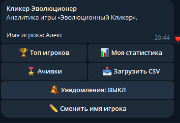
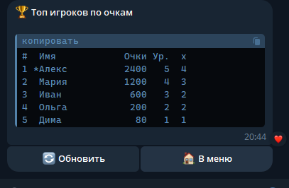
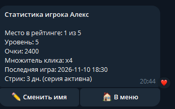
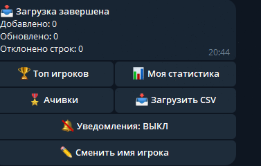

# Кликер-Эволюционер — Telegram-бот

## ЛР 3: функциональный мессенджер-бот (вариант 8)

Выполнил: Демко А.В., группа 25-СТ.

Бот читает выгрузку игры из ЛР 2 — файл `lab2/py_chameleon_clicker/clicker_profiles.csv`. Если игры рядом нет, данные можно загрузить в бота командой `/upload`.

Бот — **сервис-аналитик** для игры «Эволюционный Кликер» (ЛР 1–2), а не её копия в чате. Игровая логика остаётся в Pygame-приложении. Бот работает с данными, которые игра выгружает в файл `clicker_profiles.csv`: строит рейтинг, личную статистику, ачивки, принимает и проверяет загруженные файлы.

* * *

## Стек технологий

- **Python 3.9+** (проверено на 3.12)
- **aiogram 3.x** — асинхронная библиотека для Telegram Bot API
- Стандартная библиотека: `csv`, `json`, `logging`, `asyncio`, `pathlib`, `dataclasses`

* * *

## Структура

```
lab3/
├── bot.py               # Точка входа: хендлеры, FSM, экраны, уведомления
├── session.py           # Stateless JSON-сессии по user_id
├── analytics.py         # Разбор CSV, верификация, рейтинг, статистика, ачивки
├── keyboards.py         # Инлайн-клавиатуры
├── config.py            # Токен из .env, пути, границы проверки данных
├── test_analytics.py    # Тесты аналитики и сессий (без Telegram)
├── requirements.txt     # aiogram
├── .env
├── sessions/            # JSON-сессии пользователей (создаются при работе)
├── data/                # profiles_db.csv (общая база), play_days.json (дни игры)
├── screenshots/         # Скриншоты бота для README
└── bot_flight.log       # Лог бота (создаётся при запуске)
```

| Модуль          | Назначение                                                                    |
|-----------------|-------------------------------------------------------------------------------|
| `bot.py`        | Dispatcher, FSM, команды, callback-запросы, приём файлов, уведомления         |
| `session.py`    | `load_session` / `save_session` / `all_sessions`, изоляция по `user_id`       |
| `analytics.py`  | `parse_profiles_text`, `verify_record`, `leaderboard`, `achievements`, стрик  |
| `keyboards.py`  | Меню, «Обновить», «Отмена», «В меню»                                          |
| `config.py`     | `BOT_TOKEN`, `ADMIN_IDS`, пути, лимиты (размер файла, уровни, множитель)      |

* * *

## Запуск

1. Создайте бота в Telegram через **@BotFather** (`/newbot`) и получите токен.
2. Установите зависимости:
   ```
   pip install -r requirements.txt
   ```
3.  `.env` и впишите токен:
   ```
   BOT_TOKEN=123456:ABC...
   ADMIN_IDS=ваш_telegram_id
   ```
   Файл `.env` добавлен в `.gitignore`. Токен нельзя публиковать в репозитории. Если он утёк, отзовите его у @BotFather.
4. Запустите :
   ```
   python bot.py
   ```
5. Откройте бота в Telegram и отправьте `/start`.

Должна работать только одна копия бота: две одновременные копии конфликтуют за `getUpdates` (ошибка 409).

Тесты аналитики: `python -m unittest test_analytics -v`.

* * *

## Команды

| Команда          | Что делает                                                       |
|------------------|------------------------------------------------------------------|
| `/start`, `/menu`| Главное меню                                                     |
| `/top`           | Рейтинг игроков по очкам (топ-10)                                |
| `/stats`         | Уровень, очки, множитель, место в рейтинге и стрик дней игрока   |
| `/achievements`  | Награды игрока                                                   |
| `/upload`        | Приём и верификация CSV-файла игры                               |
| `/watch`         | Включить/выключить уведомления о новых результатах               |
| `/help`, `/cancel` | Справка, отмена текущего действия                              |
| `/log [N]`       | Админ: последние N строк `bot_flight.log`                        |
| `/broadcast`     | Админ: рассылка текста подписчикам                               |

Все команды продублированы кнопками инлайн-клавиатуры.

* * *

## Архитектура

### Stateless-сессии (JSON)

Бот не хранит состояние пользователей в глобальной памяти. Профиль каждого пользователя лежит в `sessions/<user_id>.json`: перед действием файл читается, после — записывается (через временный файл и `os.replace`). Пользователи изолированы по `user_id`. Отсутствующий или повреждённый файл заменяется новой сессией.

Пример `sessions/123456789.json`:

```json
{
  "state": "MENU",
  "name": "Мира",
  "pending": null,
  "subscribed": true,
  "screen_message_id": 482,
  "screen_chat_id": 123456789
}
```

### FSM (конечный автомат)

| Состояние   | Что бот ждёт                         | Выход                      |
|-------------|--------------------------------------|----------------------------|
| `MENU`      | Выбор в меню                         | —                          |
| `UPLOAD`    | CSV-файл (`StateFilter(UPLOAD)`)     | файл принят или «Отмена»   |
| `WAIT_NAME` | Имя игрока                           | имя введено или «Отмена»   |
| `BROADCAST` | Текст рассылки (только админ)        | отправка или «Отмена»      |

FSM отвечает на вопрос «что бот сейчас ждёт», JSON-сессия — «кто этот пользователь и что о нём известно». Режим дублируется в сессии (`state`): после перезапуска бота `RestoreStateMiddleware` восстанавливает FSM из файла. Команды `/start`, `/cancel` не имеют `StateFilter`, поэтому работают из любого режима.

### Антифлуд: экраны правятся через edit_text

Для каждого пользователя существует одно сообщение-экран. Его `message_id` и `chat_id` хранятся в сессии, а любой новый экран редактирует это сообщение (`bot.edit_message_text`). Ошибка `message is not modified` игнорируется. Если сообщение удалено, отправляется новое. Сообщения-команды пользователя удаляются, чат остаётся чистым.

### Аналитика и верификация

Бот объединяет два источника: выгрузку игры (`../lab2/py_chameleon_clicker/clicker_profiles.csv`) и общую базу загруженных файлов (`data/profiles_db.csv`). Для одного имени остаётся запись с более поздней датой.

Каждая строка загружаемого CSV проверяется (`verify_record`):

| Проверка            | Правило                                                              |
|---------------------|----------------------------------------------------------------------|
| Заголовок           | `Имя,Уровень,Очки,Множитель,Дата`                                    |
| Число полей         | ровно 5                                                              |
| Числа               | уровень, очки, множитель — целые                                     |
| Имя                 | не пустое, до 20 символов                                            |
| Уровень, множитель  | 1..10 и 1..5 (по настройкам игры)                                    |
| Очки и уровень      | очки правдоподобны для уровня: от `25·L·(L−1)` до `125·L·(L+1)`      |
| Дата                | формат `ГГГГ-ММ-ДД ЧЧ:ММ`, не в будущем                              |
| Файл                | `.csv`, до 1 МБ, кодировка UTF-8 (проверка до разбора)               |

Ошибочные строки отклоняются с указанием номера строки, остальные принимаются. Бот не падает на битом файле.

### Таблица лидеров

Сортировка: очки по убыванию, при равенстве — уровень, затем множитель. Выводится топ-10 в тегe `<pre>`, имена экранируются (`html.escape`).

### Стрик дней

В CSV игры хранится только дата **последней** игры. Поэтому бот запоминает каждый день, который встретил в данных (`data/play_days.json`), и считает серию дней подряд, оканчивающуюся последним известным днём. Стрик точен, пока бот получает данные регулярно (при запуске, при загрузке файла и при изменении файла игры).

### Ачивки

| Ачивка           | Условие                  |
|------------------|--------------------------|
| Новичок          | сыграна хотя бы одна игра|
| Меткий глаз      | множитель x3 и выше      |
| Комбо-мастер     | множитель x5             |
| Эволюция         | уровень 5 и выше         |
| Хамелеон         | уровень 10               |
| Тысячник         | 1000 очков               |
| Постоянный игрок | стрик 3 дня и больше     |

### Уведомления (`/watch`)

Подписка хранится в сессии (`subscribed`). Подписчики получают сообщение, когда: (1) кто-то загрузил файл с новыми или улучшенными результатами; (2) наблюдатель `watch_game_file` заметил изменение CSV игры (проверка раз в 30 секунд). Список подписчиков собирается из файлов сессий.

### Прочее

- Файловые операции выполняются через `asyncio.to_thread`, чтобы не блокировать цикл событий.
- Глобальный обработчик ошибок `dp.errors()` пишет traceback в лог и показывает пользователю «Временный сбой».
- `callback.answer()` вызывается всегда, просроченные запросы перехватываются.
- Бот работает только в личных сообщениях. Админские команды проверяют `ADMIN_IDS`.

* * *

## Пример выгрузки игры (clicker_profiles.csv)

```
Имя,Уровень,Очки,Множитель,Дата
Мира,4,1340,5,2026-10-28 01:19
гг,3,510,4,2026-10-27 20:00
керос,3,280,3,2026-10-26 18:30
```

## Лог бота (bot_flight.log)

```
2026-10-28 02:10:01 | INFO | Бот запускается
2026-10-28 02:10:15 | INFO | Команда /start от 123456789
2026-10-28 02:10:40 | INFO | Загрузка от 123456789: добавлено 3, обновлено 0, отклонено 1
2026-10-28 02:11:02 | INFO | Пользователь 123456789: подписка True
```

* * *

## Скриншоты

Скриншоты бота в Telegram:






* * *

## Тестирование

- `python -m unittest test_analytics -v` — разбор CSV, верификация, слияние, рейтинг, стрик, ачивки, сессии (битый файл, изоляция).
- Вручную в Telegram: все кнопки, загрузка корректного и битого CSV, запуск с двух аккаунтов (изоляция сессий), удаление `sessions/<id>.json` при работающем боте (создаётся новая), быстрые повторные нажатия (экран не дублируется).
