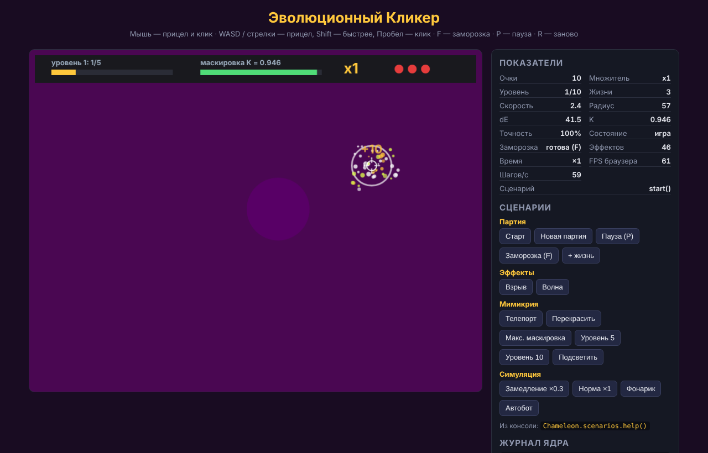
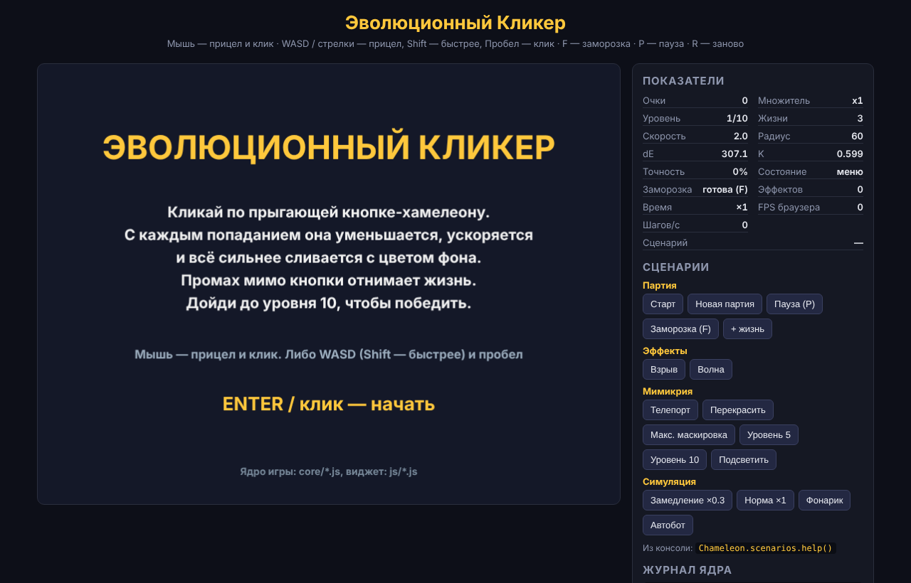
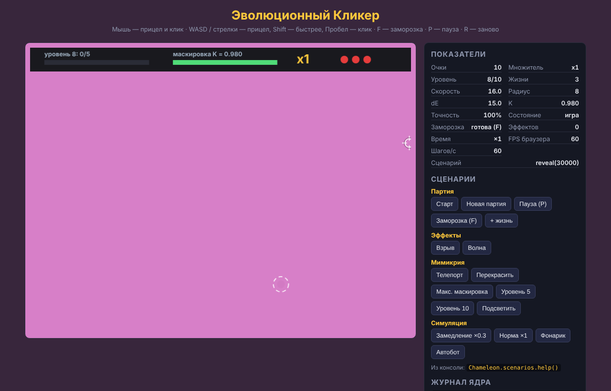
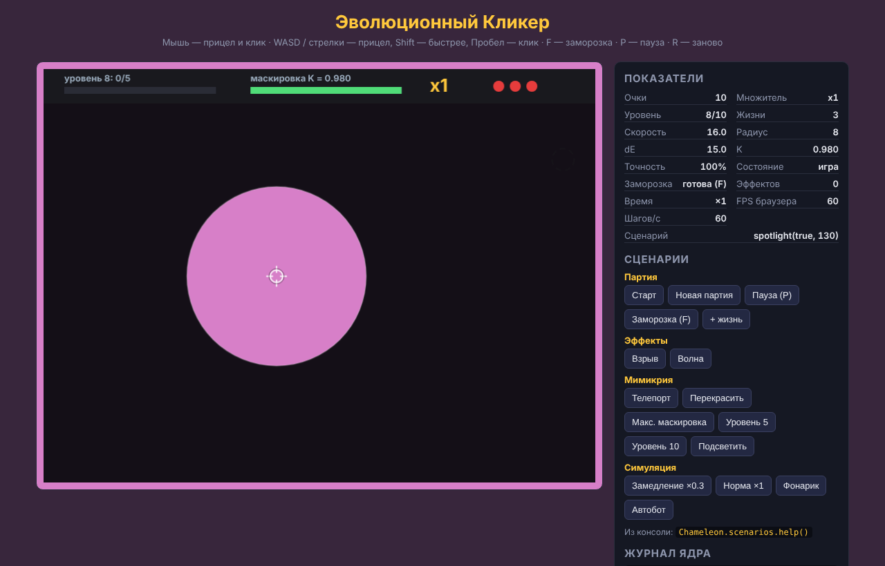
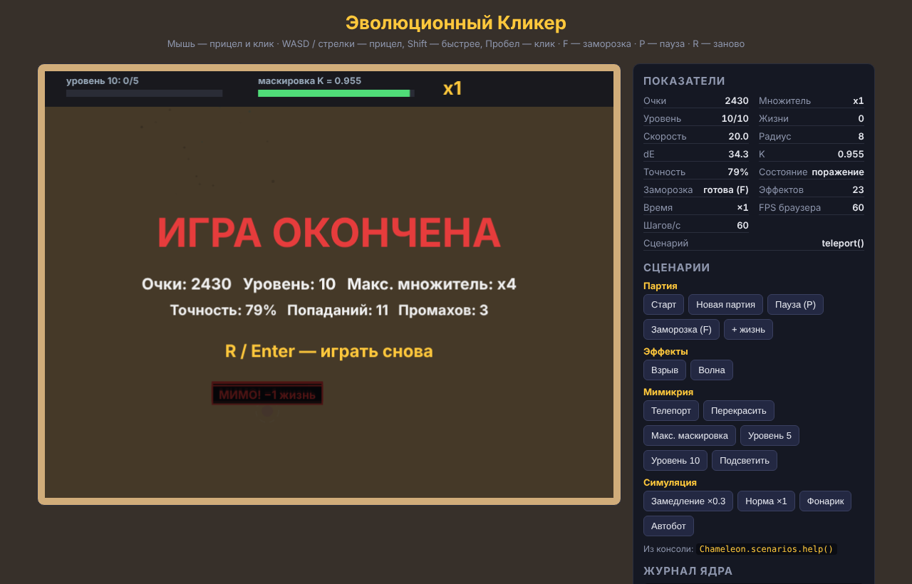

# Chameleon Clicker — веб-виджет на Canvas

## ЛР 5: веб-виджет с вызываемыми сценариями JavaScript (вариант 8)

Выполнил: Демко А.В., группа 25-СТ.

Интерактивный виджет игры «Эволюционный Кликер» на HTML5 Canvas. Кнопка-мишень постоянно движется по экрану. По клику срабатывает взрыв частиц, а цвета страницы, холста и самой кнопки мгновенно пересчитываются. Игровая логика (попадание, радиус, скорость, цвета, Delta E, коэффициент маскировки, очки, состояния) — это ядро из ЛР 4. Его копия лежит в `core/`, так что папка `lab5` **самодостаточна**: ничего из `lab4` для запуска не нужно.



* * *

## Запуск

Нужен Node.js 18+ (`node --version`). Внешние библиотеки не нужны.

```
cd lab5
node server.js
```

Затем откройте в Chrome (или любом другом браузере) **http://localhost:8000/** (остановить сервер: Ctrl+C).

**Почему нужен сервер.** Браузер блокирует ES-модули (`<script type="module">`, `import`) при открытии `index.html` двойным щелчком (адрес `file://`). Страницу нужно открывать по HTTP.

Вместо `server.js` подойдёт любой статический сервер, запущенный **из папки `lab5`**:

```
python3 -m http.server 8000     # затем http://localhost:8000/
```

Расширение Live Server в VS Code тоже работает: откройте папку `lab5`, правый клик по `index.html` → **Open with Live Server**.

Самопроверка частей, не зависящих от браузера (цикл, эффекты, ввод, сценарии):

```
cd lab5
node selftest.js      # 59 проверок
```

* * *

## Управление

| Действие | Мышь | Клавиатура |
|----------|------|------------|
| Начать партию | клик по холсту | `Enter`, пробел |
| Прицел | движение мыши | `W` `A` `S` `D` или стрелки (`Shift` — вдвое быстрее) |
| Выстрел | ЛКМ / касание | пробел, `Enter` |
| Заморозка кнопки (3 с, кулдаун 10 с) | кнопка «Заморозка» | `F` |
| Пауза | кнопка «Пауза» | `P` |
| Играть заново (после победы/поражения) | кнопка «Новая партия» | `R`, `Enter` |

Клавиши привязаны к физическим кнопкам (`e.code`), поэтому `WASD` работает и в русской раскладке.

Правила игры те же, что в ЛР 1–4: промах мимо кнопки отнимает жизнь (всего 3), каждое попадание уменьшает кнопку, ускоряет её и сближает её цвет с фоном. Победа — пройти 10 уровней.

* * *

## Структура

```
lab5/
├── index.html          # разметка: canvas, панель показателей, кнопки сценариев
├── css/
│   └── style.css       # тёмная тема, сетка «холст + панель»
├── core/               # ядро игры из ЛР 4 (без изменений): ChameleonEngine, TargetButton, colorMath, ...
├── data/
│   └── clicker_config.json  # настройки игры (из ЛР 4)
├── js/
│   ├── main.js         # точка входа: загрузка настроек, запуск, глобальный объект Chameleon
│   ├── widget.js       # класс Widget: цикл rAF, шаг симуляции, клики, связка модели и представления
│   ├── loop.js         # FixedStepLoop: накопитель, фиксированный шаг
│   ├── input.js        # KeyboardInput: ввод массивом-флагов
│   ├── renderer.js     # Renderer: отрисовка мира, сущностей, эффектов, экранов
│   ├── effects.js      # модель эффектов: Particle, Shockwave, FloatingText, Marker, EffectsSystem
│   ├── hud.js          # Hud: запись показателей в существующие DOM-элементы
│   └── scenarios.js    # реестр вызываемых сценариев
├── server.js           # статический сервер (раздаёт папку lab5)
├── selftest.js         # самопроверка (59 проверок)
├── package.json
└── screenshots/        # скриншоты виджета
```

Ядро скопировано из `lab4/js/` в `core/` **без изменений** и подключается обычным `import`:

```js
import { ChameleonEngine } from '../core/chameleonEngine.js';
import { GameConfig }      from '../core/gameConfig.js';
```

Настройки игры читаются из `data/clicker_config.json` (копия файла из ЛР 4).

### Модель и представление

| Модель (считает, не рисует) | Представление (рисует, не считает) |
|-----------------------------|------------------------------------|
| `core/*`: `ChameleonEngine`, `TargetButton`, `colorMath` | `renderer.js`: примитивы Canvas |
| `effects.js`: положение, `alpha`, `radius`, `alive` эффектов | `hud.js`: запись в `textContent` |
| `loop.js`: накопитель | `css/style.css`: оформление страницы |
| `scenarios.js`: меняет только модель | `index.html`: разметка |

Эффекты, цикл, ввод и сценарии не обращаются к `canvas` и `document`, поэтому проверяются в Node (`selftest.js`).

* * *

## Параметры виджета

| Параметр | Значение | Где задан |
|----------|----------|-----------|
| Холст | 800 × 600 (с учётом `devicePixelRatio`) | `core/constants.js` |
| Шаг симуляции | 1000 / 60 ≈ 16.67 мс (60 шагов в секунду) | `loop.js`, `STEP_MS` |
| Предел времени за один кадр | 100 мс (защита от «прыжка» после сворачивания вкладки) | `loop.js`, `MAX_DELTA_MS` |
| Радиус видимости («фонарик») | 150 px (меняется сценарием `spotlight`) | `widget.js` |
| Скорость прицела с клавиатуры | 6 px/шаг, с `Shift` — 12 px/шаг | `widget.js` |
| Взрыв при попадании | 44 частицы (120 при победе), жизнь 28–55 шагов | `widget.js`, `effects.js` |
| Частица | трение 0.95, гравитация 0.08 px/шаг² | `effects.js` |
| Ударная волна | растёт 3.2 px/шаг до радиуса 120, `alpha = 1 − r / maxRadius` | `effects.js` |
| Всплывающий текст | поднимается 0.9 px/шаг, живёт 50 шагов | `effects.js` |
| Маркер над кнопкой | 55–70 шагов, следует за кнопкой, гаснет последние 12 шагов | `effects.js` |
| Автобот | клик по центру кнопки каждые 15 шагов | `widget.js` |

Игровое время (`simNow`) — это число шагов × 16.67 мс. На паузе оно стоит, при замедлении идёт медленнее. Заморозка и кулдаун ядра считаются по нему же.

* * *

## Как выполнены требования варианта

> Кнопка-мишень постоянно двигается по экрану с помощью JS-таймера. Обработчик клика. При попадании — анимация взрыва частиц и мгновенный пересчёт цветов страницы/холста и самой кнопки.

- **Движение «таймером».** Вместо `setInterval` используется `requestAnimationFrame` с накопителем: он даёт ровно 60 шагов в секунду, не зависит от частоты монитора, не копит запоздавшие вызовы в фоновой вкладке. В HUD видно `FPS браузера` и `Шагов/с`: на мониторе 144 Гц FPS будет 144, а шагов по-прежнему ~60.
- **Обработчик клика.** `pointerdown` на холсте переводит координаты в систему игры (с учётом масштаба холста на странице) и кладёт клик в очередь. Очередь обрабатывается в шаге симуляции, поэтому клик и движение кнопки не конфликтуют. `pointerdown` вместо `mousedown` даёт работу и с касанием.
- **Взрыв частиц.** При попадании в точке, где кнопка была, создаются частицы, ударная волна и текст `+очки`. Цвета частиц: прежний цвет кнопки, контрастный цвет и жёлтый акцент. Контрастный нужен, потому что кнопка замаскирована под фон и частицы только её цвета были бы почти невидимы.
- **Мгновенный пересчёт цветов.** Новые фон и цвет кнопки выдаёт ядро (`makeColorPair` + `ensureVisible`). Холст перерисовывается в том же кадре. Цвет рамки холста и страницы меняется через CSS-переменные `--stage-bg` и `--page-bg`. Фон страницы — это цвет игры, смешанный с тёмным (22% / 78%), чтобы текст панели всегда читался.

### Ограниченная видимость («фонарик»)

Включается кнопкой «Фонарик» (или `Chameleon.scenarios.spotlight()`). Вне круга вокруг прицела всё затемнено. Реализация в два шага:

1. **Отбор по расстоянию.** Кнопка, которая целиком вне радиуса, даже не рисуется. Часть кнопки, выступающая за круг, обрезается `clip()`.
2. **Затемнение.** Один путь «прямоугольник минус круг» с правилом `evenodd`: слоёв и масок не нужно.

### Индикаторы над сущностью

Маркер следует за кнопкой (положение берётся из функции-«якоря» каждый шаг), покачивается и в первые шаги «всплескивает» размером. Появляется при событиях: `МИМО! −1 жизнь`, `УРОВЕНЬ N`, `ЗАМОРОЗКА`.

* * *

## Сценарии

Сценарий — именованная функция, меняющая состояние или поведение виджета. Все сценарии собраны в реестр `createScenarios(widget)` в `js/scenarios.js`. Каждый вызов записывается в журнал ядра (запись `SCENARIO`) и показывается в HUD в строке «Сценарий».

Три способа вызова:

1. **Кнопки на странице:** `<button data-scenario="setLevel" data-args="[5]">`. Аргументы — JSON-массив в `data-args`.
2. **Консоль браузера:** глобальный объект `Chameleon`.
   ```js
   Chameleon.scenarios.explode()            // взрыв на кнопке
   Chameleon.scenarios.explode(400, 300, 100)
   Chameleon.scenarios.setLevel(9)
   Chameleon.scenarios.help()               // таблица всех сценариев
   Chameleon.engine.snapshot()              // состояние ядра
   ```
3. **Из другого сценария или кода.** `restart` вызывает `startGame`, `widget.step()` вызывает `scenarios.pause()`, `scenarios.start()` и `scenarios.freeze()` по клавишам.

| Сценарий | Что делает |
|----------|------------|
| `start()` | Начать партию (из меню, после победы или поражения) |
| `restart()` | Новая партия в любой момент: ядро создаётся заново, эффекты очищаются |
| `pause()` | Пауза / продолжить |
| `freeze()` | Заморозка кнопки на 3 с (кулдаун 10 с считает ядро) |
| `addLife()` | +1 жизнь (отладка) |
| `explode(x, y, count)` | Взрыв частиц; без аргументов — на кнопке |
| `shockwave(x, y, maxRadius)` | Ударная волна |
| `teleport()` | Телепорт кнопки в случайную точку |
| `recolor()` | Пересчитать цвета фона и кнопки для текущего уровня |
| `maxCamouflage()` | Цвет кнопки на пороге видимости (`dE = 12`, `K ≈ 0.98`) |
| `setLevel(n)` | Перейти на уровень `n`: радиус и скорость как в реальной партии, новые цвета |
| `reveal(ms)` | Подсветить кнопку пунктирным контуром на `ms` миллисекунд |
| `timeScale(factor)` | Масштаб времени симуляции: `0.3` — замедление, `1` — норма |
| `spotlight(enabled, radius)` | Ограниченная видимость: без аргументов переключает |
| `autoplay(enabled)` | Бот кликает по центру кнопки каждые 15 шагов |

Аргументы из консоли проходят проверку: нечисловые значения заменяются значениями по умолчанию, числа ограничиваются допустимым диапазоном (`timeScale(100)` даст `3`). Сценарии не знают про Canvas и DOM — только про модель, поэтому `selftest.js` вызывает их без браузера.

* * *

## Игровой цикл

```
requestAnimationFrame(frame)
  frame(now):
    delta = now − last
    steps = loop.advance(delta, timeScale)    // накопитель: сколько шагов «влезло»
      └─ для каждого шага: widget.step()
            1. опрос флагов клавиатуры (пауза, старт, заморозка)
            2. simNow += шаг; движение прицела по флагам
            3. очередь кликов → engine.click(); при попадании — эффекты
            4. engine.update(simNow); effects.step()
    renderer.draw()                            // каждый кадр браузера
    hud.update()
```

Эффекты шагают вместе с ядром в `widget.step()`, а не в отрисовке: на паузе они замирают, при замедлении (`timeScale`) идут медленнее.

### Ввод: опрос флагов

`keydown`/`keyup` только отмечают состояние клавиши в объекте `{ KeyW: true, ... }`, а цикл опрашивает его каждый шаг. Для одноразовых действий (пауза, заморозка, выстрел) добавлено «запоминание тапа»: `keydown` запоминает нажатие, пока цикл его не заберёт. Без этого тап короче одного шага (16 мс) терялся бы между опросами. Это обнаружилось при проверке в автоматическом браузере, где нажатие длится доли миллисекунды. Автоповтор `keydown` при удержании одним нажатием считается. При потере фокуса окном все флаги сбрасываются, чтобы клавиши не «залипали». Для управляющих клавиш (`WASD`, стрелки, пробел, `Enter`) вызывается `preventDefault`, чтобы страница не прокручивалась.

* * *

## Что проверено

- `node selftest.js`: **59 проверок** (цикл, эффекты, ввод, сценарии).
- В браузере (Chromium, автоматизированный прогон): страница загружается без ошибок и предупреждений в консоли, ядро импортируется из `core/`, попадание мышью запускает 46 эффектов, и через 1.5 с они исчезают, `WASD` двигает прицел, автобот проходит уровни, три промаха дают экран поражения, `R` запускает новую партию, `FPS` и `Шагов/с` в HUD показывают 60 / 60.

Скриншоты:

| Меню | Попадание: частицы и волна |
|------|----------------------------|
|  |  |

| Максимальная маскировка + подсказка | «Фонарик» (ограниченная видимость) |
|-------------------------------------|-------------------------------------|
|  |  |

| Экран поражения |
|-----------------|
|  |

* * *

## Ответы на контрольные вопросы

**1. Чем игровой цикл на `requestAnimationFrame` отличается от `while True` в Pygame?**
В Pygame цикл `while True` занимает поток целиком, и программа сама ждёт нужное время (`clock.tick(60)`). В браузере такой цикл «повесил» бы вкладку: страница не перерисуется, пока код не вернёт управление. Поэтому цикл строится на обратном вызове: браузер сам вызывает `frame` перед каждой перерисовкой, а `frame` назначает следующий вызов. Бонусом браузер приостанавливает вызовы в фоновой вкладке.

**2. Зачем нужен фиксированный шаг симуляции и накопитель?**
Ядро из ЛР 4 считает «в кадрах»: скорость кнопки 2 px/кадр, кулдаун и т. д. Если двигать по реальному `delta`, на мониторе 144 Гц и на медленном устройстве поведение будет разным, а расчёты станут недетерминированными. Накопитель копирует прошедшее время и тратит его равными порциями по 16.67 мс: на любом мониторе логика идёт 60 раз в секунду, а отрисовка — как получится. Предел 100 мс за кадр не даёт симуляции «догонять» минуты после сворачивания вкладки.

**3. Почему ввод через массив-флаги плавнее, чем реакция на одиночное `keydown`?**
Пока клавиша зажата, ОС присылает `keydown` не сразу (есть начальная задержка) и нерегулярно. Если двигать прицел в обработчике, он стартует с паузой и идёт рывками. Флаги отделяют «что нажато» от «что делать»: обработчики только фиксируют состояние, а цикл читает его каждый шаг и двигает прицел на постоянное число пикселей. Движение начинается сразу и идёт равномерно. Заодно можно держать несколько клавиш (диагональ).

**4. Что произойдёт, если забыть залить экран фоном в начале кадра?**
Canvas не очищается сам и не помнит «объекты»: это просто пиксели. Всё нарисованное ранее останется, и новые кадры лягут поверх старых. Кнопка оставит шлейф, частицы и кольца размажутся, полупрозрачные эффекты будут накапливаться и всё больше непрозрачными. Поэтому каждый кадр `Renderer.draw()` начинается с `fillRect` на весь холст цветом фона.

**5. Как задаётся прозрачность в Canvas и почему `rgba(255, 0, 0, alpha)` уместнее `globalAlpha` для контуров?**
Прозрачность задаётся четвёртым компонентом цвета `rgba(r, g, b, alpha)` или свойством `globalAlpha`, которое действует на всё, что рисуется дальше. `globalAlpha` — состояние контекста: его легко забыть вернуть, и оно «просочится» на другие объекты, поэтому нужны `save()`/`restore()`. С `rgba` прозрачность — часть цвета конкретного контура: каждая волна или частица имеет свою `alpha` и ничего не ломает вокруг. К тому же `alpha` считает модель (геттер), а представление просто подставляет число в строку.

**6. Как реализовать «туман войны» и почему отбор по расстоянию дешевле послойной маски?**
В `renderer.js`: для кнопки считается `Math.hypot(b.x − cx, b.y − cy) − radius > R`. Если условие выполнено, объект не рисуется вообще (одно сравнение вместо отрисовки). Остальное затемняется одной заливкой «прямоугольник минус круг» (`evenodd`). Послойная маска требует отдельного слоя во весь экран, его рисования и композиции с основной картинкой каждый кадр. Отбор по расстоянию отсекает работу до отрисовки, а на большом уровне из тысяч тайлов экономит больше всего.

**7. Что такое вызываемый сценарий и какие три способа вызова реализованы?**
Сценарий — именованная функция, меняющая состояние или параметры виджета (взрыв, смена уровня, замедление, «фонарик»). Все сценарии лежат в реестре (объект функций). Способы вызова: (1) кнопки со `data-scenario` и `data-args`, (2) консоль через глобальный объект `Chameleon.scenarios.имя(...)`, (3) из другого сценария или кода виджета (`widget.step()` вызывает `scenarios.pause()`, `restart` вызывает `startGame`). Сценарии работают только с моделью, а не с Canvas, поэтому их можно тестировать в Node.

**8. Почему ES-модули не работают через `file://` и как это обойти?**
Для `import` браузер делает сетевой запрос с проверкой источника (CORS), а у страницы по `file://` источник «непрозрачный», поэтому запросы к соседним файлам блокируются. Нужен HTTP: любой статический сервер, запущенный из папки `lab5` (`node server.js`, `python3 -m http.server`, Live Server).

**9. Зачем HUD обновляет `textContent` существующих элементов, а не создаёт новые?**
Создание узлов 60 раз в секунду нагружает браузер: приходится создавать и удалять элементы, сборщик мусора работает, страница мигает, а выделение текста и фокус сбиваются. Элементы `id="hud-..."` создаются один раз в `index.html`, а `Hud.set()` меняет только их текст. К тому же значение записывается, лишь когда оно изменилось (хранится кэш), так что в стабильных кадрах DOM вообще не трогается.

**10. Какие части виджета относятся к модели, а какие к представлению?**
Модель: ядро `core/*` (игровая логика, цвета, состояния), `effects.js` (положение, `alpha`, срок жизни эффектов), `loop.js` (время симуляции), `scenarios.js` (изменяют только модель). Представление: `renderer.js` (Canvas), `hud.js` и `index.html` (DOM), `css/style.css`. `widget.js` — связующий слой: он принимает события (клик, клавиши), передаёт их модели и запускает отрисовку. Правило: модель решает, что происходит, представление только показывает.
