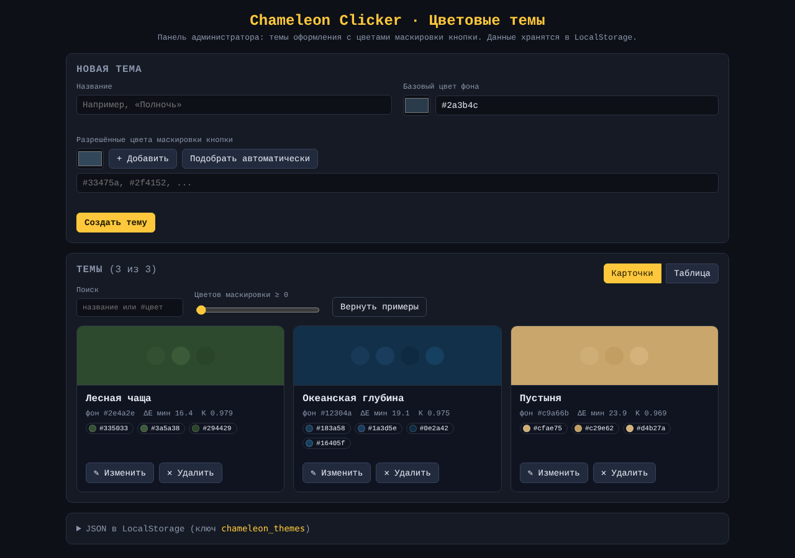
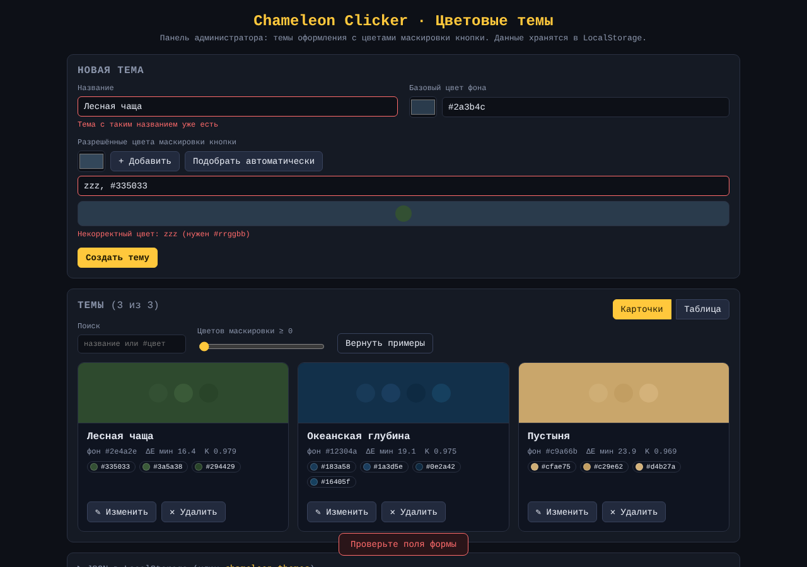
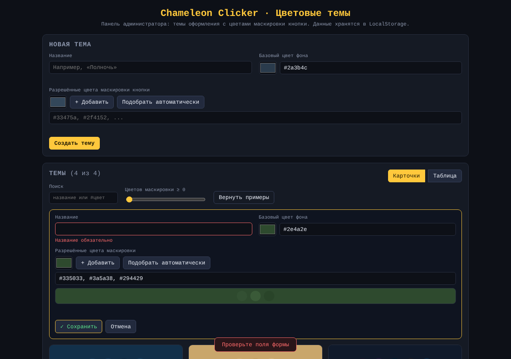
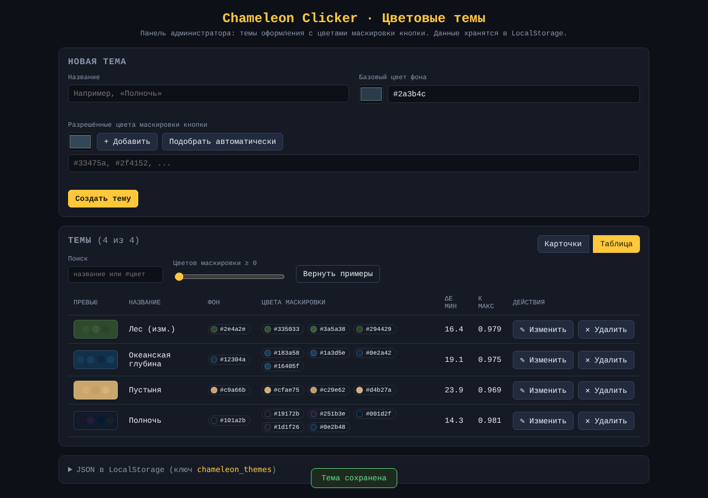

# Chameleon Clicker — панель «Цветовые темы»

## ЛР 6: веб-приложение CRUD средствами JavaScript (вариант 8)

Выполнил: Демко А.В., группа 25-СТ.

Панель администратора для игры «Эволюционный Кликер»: управление **цветовыми темами оформления**. Тема — это название, базовый цвет фона и набор разрешённых цветов, которыми кнопка-мишень маскируется под фон. Темы создаются, просматриваются в виде превью-карточек, редактируются и удаляются. Все изменения сразу сохраняются в LocalStorage (JSON-массив).



* * *

## Запуск

Нужен Node.js 18+ (`node --version`). Внешние библиотеки не нужны.

```
cd lab6
node server.js
```

Откройте в Chrome **http://localhost:8000/** (остановить сервер: Ctrl+C).

Страницу нужно открывать по HTTP, а не двойным щелчком по `index.html` (`file://`): браузер блокирует ES-модули, на которых написан код. Подойдёт любой статический сервер, запущенный **из папки `lab6`**:

```
python3 -m http.server 8000      # на Windows: python -m http.server 8000
```

Расширение Live Server в VS Code тоже работает (откройте папку `lab6`, правый клик по `index.html` → Open with Live Server).

Самопроверка частей, не зависящих от браузера:

```
cd lab6
node selftest.js      # 64 проверки
```

**Важно.** LocalStorage привязан к origin (адрес + порт). Данные, сохранённые на `http://localhost:8000`, не видны на `http://localhost:5500` или `http://127.0.0.1:8000`.

* * *

## Структура

```
lab6/
├── index.html          # каркас: форма создания, фильтры, карточки, таблица, JSON-панель
├── css/
│   └── style.css       # тёмная тема, моноширинный шрифт
├── js/
│   ├── crud.js         # интерфейс: рендер, делегирование событий, формы, фильтры
│   ├── store.js        # модель: create / update / remove, фильтр, статистика маскировки, подбор цветов
│   ├── storage.js      # слой LocalStorage: load / save, миграция записей, защита от битого JSON
│   ├── validation.js   # валидация темы
│   ├── utils.js        # escapeHtml, generateId (UUID), работа с HEX-цветами
│   └── core/           # расчёты цвета из ЛР 4: deltaE, коэффициент маскировки, ensureVisible
│       ├── colorMath.js
│       └── constants.js
├── server.js           # статический сервер (встроенные модули Node)
├── selftest.js         # самопроверка (64 проверки)
├── package.json
└── screenshots/
```

Логика разделена по ролям: `crud.js` отвечает за экран, `store.js` и `storage.js` за данные, `validation.js` за правила. Модули, кроме `crud.js`, не обращаются к DOM, поэтому проверяются в Node.

* * *

## Сущность «Тема»

Хранится как элемент JSON-массива под ключом **`chameleon_themes`**:

```json
{
  "id": "6c257fc3-e827-4ed0-8751-081260b2f99e",
  "name": "Лесная чаща",
  "background": "#2e4a2e",
  "allowedColors": ["#335033", "#3a5a38", "#294429"],
  "createdAt": "2026-11-22T10:15:00.000Z"
}
```

| Поле | Тип | Правила |
|------|-----|---------|
| `id` | строка | UUID v4, генерируется `crypto.randomUUID()` при создании, не редактируется |
| `name` | строка | обязательно, 2–40 символов, уникально без учёта регистра |
| `background` | строка | обязательно, цвет вида `#rrggbb` (принимаются также `#abc` и без `#`, хранится приведённым) |
| `allowedColors` | массив строк | от 1 до 12 цветов `#rrggbb`, без повторов; каждый должен отличаться от фона на **ΔE ≥ 12** |
| `createdAt` | строка | дата создания (ISO), ставится автоматически |

**Правило ΔE ≥ 12** взято из ЛР 4: кнопка не должна быть абсолютно невидимой. Если задать цвет, почти совпадающий с фоном, форма покажет, какой именно цвет слишком близок и чему равна его ΔE.

На карточке и в таблице для каждой темы считаются (формулами из ЛР 4, `js/core/colorMath.js`):

- **ΔE мин** — расстояние (упрощённая Delta E «redmean») до самого незаметного цвета. Чем меньше, тем сильнее кнопка сливается с фоном;
- **K макс** — коэффициент маскировки этого цвета: `K = 1 − ΔE / ΔE_max`, от 0 до 1 (1 — полное слияние).

* * *

## Возможности

| Операция | Как работает |
|----------|--------------|
| **Create** | форма вверху страницы: название, фон (палитра + HEX), цвета (палитра + «+ Добавить», поле со списком через запятую или кнопка «Подобрать автоматически»). Ошибки выводятся под полями, после успеха форма очищается |
| **Read** | превью-карточки (по умолчанию) и таблица, переключатель «Карточки / Таблица». Превью: фон темы с кружками цветов маскировки |
| **Фильтры** | поиск по названию или HEX-цвету и **ползунок «Цветов маскировки ≥ N»** (числовое поле) |
| **Update** | кнопка «Изменить» заменяет карточку или строку таблицы формой с текущими значениями. «Сохранить» (или Enter) проверяет данные и сохраняет, «Отмена» (или Esc) возвращает без изменений |
| **Delete** | «Удалить» с подтверждением `confirm()` и уведомлением |
| **LocalStorage** | после каждой операции массив записывается целиком, внизу страницы раскрывающаяся панель с текущим JSON |

Дополнительно: живое превью цветов в формах, «Вернуть примеры» (3 готовые темы), синхронизация между вкладками (событие `storage`), предупреждение, если LocalStorage недоступен или данные повреждены.







* * *

## Как тестировать

1. **Create.** Нажмите «Подобрать автоматически» (цвета подберутся рядом с фоном), введите название, нажмите «Создать тему». Карточка появится в списке, форма очистится.
2. **Валидация.** Введите название, которое уже есть («Лесная чаща»), в поле цветов `zzz`: появятся сообщения под полями, запись не добавится. Введите цвет, почти совпадающий с фоном (например, фон `#2a3b4c`, цвет `#2a3b4d`): форма сообщит про ΔE.
3. **Фильтр.** Подвиньте ползунок «Цветов маскировки ≥»: останутся только темы с нужным числом цветов. Введите в поиск часть названия или HEX.
4. **Update.** Нажмите «✎ Изменить», очистите название и нажмите «Сохранить»: появится ошибка. Введите новое название и нажмите Enter: тема обновится. То же самое в режиме «Таблица».
5. **Delete.** Нажмите «✕ Удалить», подтвердите.
6. **Персистентность.** Откройте DevTools (F12) → **Application → Local Storage → http://localhost:8000**: ключ `chameleon_themes` содержит JSON-массив, он меняется после каждой операции. Перезагрузите страницу (F5): все темы на месте.
7. **XSS.** Создайте тему с названием ``: оно отобразится текстом, `alert` не сработает.
8. **Сброс.** Выполните в консоли `localStorage.clear()` и перезагрузите страницу: вернутся три примера.

Из консоли доступен объект `ThemeAdmin`: `ThemeAdmin.store.list()` возвращает текущие темы.

* * *

## Соответствие критериям

| Критерий | Где |
|----------|-----|
| Create: форма + валидация + генерация ID + сохранение | `index.html` (форма), `crud.js` (обработчик `submit`), `store.js` (`create`), `validation.js`, `utils.js` (`generateId`) |
| Read: таблица + фильтр по числовому полю | `crud.js` (`render`, карточки и таблица), `store.js` (`filterThemes`), ползунок `#filterColors` |
| Update: инлайн-редактирование с валидацией | `crud.js` (`editFields`, `startEdit`, `saveEdit`), `store.js` (`update`) |
| Delete: удаление с обновлением хранилища | `crud.js` (`confirmDelete`), `store.js` (`remove`) |
| LocalStorage: персистентность | `storage.js`, ключ `chameleon_themes` |
| XSS-защита и валидация чисел | `utils.js` (`escapeHtml`, `safeHex`), `validation.js` |
| README и структура | этот файл |

* * *

## Ответы на контрольные вопросы

**1. Почему localStorage хранит только строки и как сохранять объекты?**
localStorage — это хранилище пар «ключ → строка». Значение, которое не является строкой, браузер приводит к строке, и объект превращается в бесполезное `"[object Object]"`. Поэтому перед записью объект сериализуют в JSON (`JSON.stringify`), а после чтения разбирают обратно (`JSON.parse`). В коде это `ThemeStorage.save()` и `ThemeStorage.load()`.

**2. Чем `crypto.randomUUID()` лучше `Date.now() + Math.random()` для ID?**
`Math.random()` не криптографический генератор: его результаты предсказуемы и могут повторяться. `Date.now()` даёт одинаковое значение при двух вызовах в одну миллисекунду (например, при быстрых действиях или в двух вкладках). UUID v4 содержит 122 случайных бита из криптографического генератора, поэтому совпадение практически невозможно, а формат стандартизован. На адресах без HTTPS (не `localhost`) `randomUUID` недоступен, поэтому в `generateId()` есть запасной вариант на `crypto.getRandomValues`.

**3. Что такое делегирование событий и зачем оно нужно в таблице с кнопками?**
Событие клика «всплывает» от кнопки вверх по дереву. Вместо отдельного обработчика на каждой кнопке вешается один на контейнер (`#cards`, `tbody`), а внутри по `event.target.closest('button')` и классу (`btn-edit`, `btn-delete`, ...) определяется действие. Это важно, потому что список перерисовывается через `innerHTML`: старые кнопки удаляются, а новые создаются без обработчиков. Обработчик на контейнере остаётся и работает для любых новых кнопок. Плюс меньше обработчиков в памяти.

**4. Как работает `escapeHtml` и почему без него возможна XSS-уязвимость?**
Функция заменяет `&`, `<`, `>`, `"`, `'` на HTML-сущности (`&amp;`, `&lt;` и т. д.), и браузер показывает их как обычные символы, а не как разметку. Без неё название ``, вставленное в `innerHTML`, превратилось бы в живой тег, и браузер выполнил бы чужой скрипт с правами страницы (кража данных, подмена интерфейса). `escapeHtml` вызывается в `crud.js` для каждой строки из данных (название, HEX, `id`) при построении карточек, строк и полей редактирования. Для цветов внутри `style="..."` используется `safeHex`: любое значение, не похожее на `#rrggbb`, заменяется на чёрный.

**5. В чём разница между HTML5-валидацией и JS-валидацией?**
HTML5-атрибуты (`required`, `minlength`, `maxlength`) проверяет сам браузер до отправки формы: это быстро и ничего не требует писать, но проверки простые, их можно отключить или обойти через DevTools, а сообщения не настраиваются. JS-валидация (`validateTheme`) выражает правила предметной области: уникальность названия, формат HEX, отсутствие повторов, ΔE ≥ 12. Она работает и для формы создания, и для редактирования строки (где нет `<form>`), и защищает хранилище независимо от интерфейса. Поэтому форма создания использует обе, а в хранилище попадает только то, что прошло JS-проверку.

**6. Почему после каждой операции CRUD вызывается `save()` целиком, а не «дифф»?**
В localStorage под ключом лежит одна строка: частично обновить её нельзя, можно только записать новую целиком. Для небольшого списка (до сотен записей) это дёшево, а код остаётся простым и надёжным: в хранилище всегда согласованное состояние, нет риска рассинхронизации «дифф + старое состояние». Запись одним вызовом `setItem` ещё и атомарна: либо записалось всё, либо ничего.

**7. Как реализовать фильтр без перерисовки всей таблицы?**
Не пересоздавать строки, а переключать их видимость: отрисовать все строки один раз с `data-id`, а при изменении фильтра для каждой строки вычислять предикат и ставить `row.hidden = !подходит`. Для сложных случаев используют сопоставление по ключу (`id`) и обновление только изменившихся ячеек. В этой работе список перерисовывается целиком (`render()`): для десятков записей это незаметно и проще, а для тысяч записей уже стоило бы переключать `hidden` или использовать виртуализацию.

**8. Что произойдёт, если пользователь откроет страницу в режиме инкогнито и добавит запись?**
Всё будет работать, но хранилище инкогнито изолировано от обычного профиля: темы из обычного режима не видны, а добавленная запись исчезнет после закрытия всех окон инкогнито. При первом запуске там не будет данных, и приложение создаст примеры. В некоторых браузерах в приватном режиме запись может быть запрещена или ограничена по размеру. Поэтому `ThemeStorage` при создании проверяет доступность `setItem` и при ошибке переходит на хранение в памяти с предупреждением на странице.

**9. Почему localStorage недоступен в `iframe` с `sandbox` без `allow-storage-access`?**
Атрибут `sandbox` без `allow-same-origin` лишает документ его origin: страница считается пришедшей из «непрозрачного» источника, и обращение к `localStorage` бросает `SecurityError`. Ограничение действует и для встроенных чужих сайтов: браузеры дополнительно разделяют или блокируют их хранилище (защита от слежки), а доступ к нему возвращают разрешения вроде `allow-same-origin` и Storage Access API. Поэтому доступ к `localStorage` обёрнут в `try/catch`: приложение не падает, а работает «в памяти» и сообщает об этом пользователю.

**10. Как мигрировать данные, если в следующем семестре к сущности добавится новое поле?**
Старые записи в localStorage не содержат нового поля, поэтому при чтении их нужно приводить к новой схеме. В коде это делает `normalizeTheme()`: если поля нет, подставляется значение по умолчанию (так, например, уже обрабатывается отсутствие `id` и `createdAt`), а совсем повреждённые записи отбрасываются. Новое поле достаточно добавить туда и в `validateTheme`. Для несовместимых изменений формата удобно хранить версию схемы (`schemaVersion` или ключ `chameleon_themes_v2`), при запуске определять версию и один раз выполнить функцию миграции `v1 → v2`, после чего сохранить данные в новом формате.
