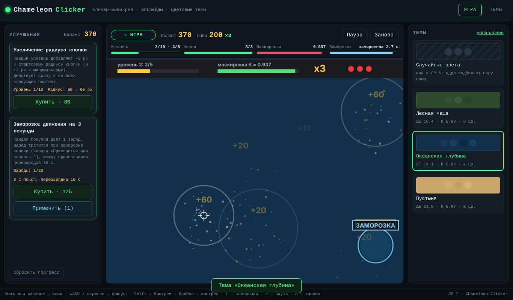
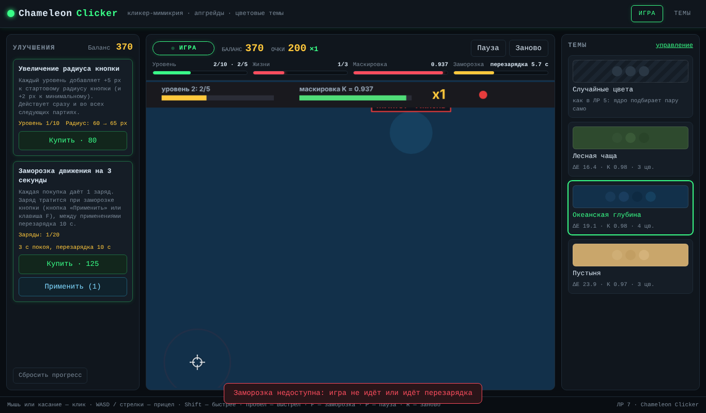
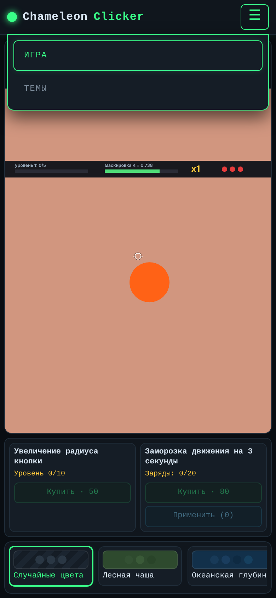

# Chameleon Clicker — сайт-кликер

## ЛР 7: веб-сайт средствами HTML, CSS и JavaScript (вариант 8)

Выполнил: Демко А.В., группа 25-СТ.

Многостраничный адаптивный сайт, который объединяет три предыдущие работы в одно приложение:

- **ядро игры** из ЛР 4 (правила, цвета, Delta E, коэффициент маскировки);
- **игровой виджет на Canvas** из ЛР 5 (цикл с фиксированным шагом, эффекты, ввод);
- **панель тем (CRUD в LocalStorage)** из ЛР 6, карточки которой образуют хотбар.

Вариант 8: игровое поле занимает большую часть экрана, вокруг него расположены панели. За очки, заработанные кликами, покупаются улучшения «Увеличение радиуса кнопки» и «Заморозка движения на 3 секунды». Баланс и настройки улучшений читаются из LocalStorage и обновляются в нём после каждого изменения.



* * *

## Запуск

Нужен Node.js 18+ (`node --version`). Внешние библиотеки не нужны.

```
cd lab7
node server.js
```

Откройте в Chrome **http://localhost:8000/** (остановить сервер: Ctrl+C).

Сайт нужно открывать по HTTP, а не двойным щелчком по `index.html` (`file://`): ES-модули при таком способе блокируются. Подойдёт любой статический сервер, запущенный **из папки `lab7`**:

```
python3 -m http.server 8000      # на Windows: python -m http.server 8000
```

Расширение Live Server в VS Code тоже работает (откройте папку `lab7`, правый клик по `index.html` → Open with Live Server).

Самопроверка частей, не зависящих от браузера:

```
cd lab7
node selftest.js      # 213 проверок
```

**Важно.** LocalStorage привязан к origin (адрес и порт). Данные с `http://localhost:8000` не видны на `http://127.0.0.1:8000` или на другом порту.

* * *

## Страницы

| Страница | Что на ней |
|----------|------------|
| `index.html` — **Игра** | шапка с навигацией, магазин улучшений, динамический HUD, Canvas-виджет, хотбар тем, подвал с подсказками |
| `pages/themes.html` — **Темы** | панель CRUD из ЛР 6 (создание, редактирование, удаление цветовых тем) в общем каркасе сайта |

Темы, созданные на странице «Темы», сразу появляются в хотбаре на странице «Игра», в том числе в уже открытой другой вкладке и без перезагрузки.

* * *

## Управление

| Действие | Мышь / касание | Клавиатура |
|----------|----------------|------------|
| Начать партию | клик или тап по полю | `Enter`, пробел |
| Прицел | движение мыши | `W` `A` `S` `D` или стрелки (`Shift` — вдвое быстрее) |
| Выстрел | клик или тап | пробел, `Enter` |
| Заморозка кнопки | кнопка «Применить» в магазине | `F` |
| Пауза | кнопка «Пауза» | `P` |
| Заново | кнопка «Заново»; после конца партии клик или тап по полю | `R`, `Enter` (после конца партии) |
| Выбрать тему | клик по карточке в хотбаре | — |

На телефоне всё управляется касаниями, клавиатура не нужна. Управление с клавиатуры подключено из виджета (`js/widget/controls.js` и `js/widget/input.js`: массив-флаги, `preventDefault` для клавиш движения).

* * *

## Структура

```
lab7/
├── index.html              # главная: шапка, навигация, магазин, HUD, поле, хотбар, подвал
├── pages/
│   └── themes.html         # вторая страница: панель CRUD тем (ЛР 6)
├── css/
│   ├── style.css           # единый стиль: переменные, шапка, бургер, Grid-каркас, HUD, медиазапросы
│   └── themes.css          # стили панели CRUD (только страница «Темы»)
├── js/
│   ├── site.js             # навигация («бургер») и уведомления: подключается на каждой странице
│   ├── widget-integration.js   # сборка главной: виджет + магазин + хотбар + HUD, хуки, подмена сценариев
│   ├── hotbar.js           # хотбар: карточки тем из LocalStorage, выбор темы
│   ├── hud.js              # динамический HUD: показатели из движка, смена вида индикаторов
│   ├── shop.js             # интерфейс магазина улучшений
│   ├── economy.js          # модель: баланс и улучшения в LocalStorage (без DOM)
│   ├── gameBridge.js       # мост с ядром: конфиг с бонусом радиуса, цвета по теме (без DOM)
│   ├── core/               # ядро игры из ЛР 4 (без изменений)
│   ├── widget/             # Canvas-виджет из ЛР 5 (widget, loop, input, controls, effects, renderer, scenarios)
│   └── themes/             # панель тем из ЛР 6 (crud, store, storage, validation, utils)
├── data/
│   └── clicker_config.json # настройки игры (из ЛР 4)
├── server.js               # статический сервер
├── selftest.js             # самопроверка (213 проверок)
├── package.json
└── screenshots/
```

Модули разделены по ответственности: `economy.js`, `gameBridge.js`, `hud.js` (его логика состояний) и `core/` не обращаются к DOM и проверяются в Node. Интерфейс (`shop.js`, `hotbar.js`, `hud.js`, `crud.js`) только показывает данные и принимает действия.

**Как подключены модули ядра и виджета.** Все пути относительные и лежат внутри `lab7/js/`: главная страница подключает один модуль `<script type="module" src="js/widget-integration.js">`, а тот импортирует остальное:

```js
import { Widget } from './widget/widget.js';   // виджет из ЛР 5
// внутри widget.js:
import { ChameleonEngine } from '../core/chameleonEngine.js';   // ядро из ЛР 4
```

Благодаря копиям ядра и виджета внутри папки `lab7` проект запускается сам по себе, без соседних папок репозитория.

* * *

## Каркас: CSS Grid и Flexbox

**CSS Grid** задаёт двумерный каркас главной страницы (`.game-shell`). Области названы через `grid-template-areas`, поэтому раскладка читается как схема и легко пересобирается под разные экраны:

```
 ширина > 1100px (десктоп)              ≤ 1100px (планшет)           ≤ 768px (телефон)
┌────────┬───────────┬────────┐        ┌────────────┬────────┐      ┌──────────────┐
│ header │  header   │ header │        │   header   │ header │      │    header    │
├────────┼───────────┼────────┤        ├────────────┼────────┤      ├──────────────┤
│        │   hud     │        │        │    hud     │        │      │     hud      │
│upgrades├───────────┤ hotbar │        ├────────────┤upgrades│      ├──────────────┤
│        │   stage   │        │        │   stage    │        │      │    stage     │
├────────┴───────────┴────────┤        ├────────────┴────────┤      ├──────────────┤
│           footer            │        │   hotbar (полоса)   │      │   upgrades   │
└─────────────────────────────┘        │       footer        │      │   hotbar     │
                                       └─────────────────────┘      └──────────────┘
```

Строка с игровым полем имеет высоту `minmax(0, 1fr)`: она занимает всё, что осталось от окна после шапки и панелей, и не растягивается под размер холста.

**Flexbox** отвечает за одномерные блоки внутри областей: шапка (логотип, навигация, бургер), боковые панели (колонка карточек с `gap`), строка показателей HUD, ряд кнопок, горизонтальная полоса хотбара на узких экранах.

**Единый стиль** вынесен в переменные `:root` в `css/style.css` (палитра, шрифт, тени). Оба HTML-файла подключают один и тот же `style.css`, поэтому шапка, кнопки, панели и цвета одинаковы на всех страницах. Состояния различаются цветом: неоново-зелёный — активное и спокойное, жёлтый — среднее, красный — критическое, голубой — заморозка.


## Хотбар тем

Карточки строятся из массива тем в LocalStorage (ключ `chameleon_themes`): превью (фон и кружки цветов маскировки), название, ΔE и коэффициент K, число цветов. Первая карточка «Случайные цвета» возвращает поведение ЛР 5, когда ядро подбирает пару цветов само.

**Клик по карточке** выбирает тему: рамка выделения, запись в `chameleon_selected_theme` и применение в игре:

- фон поля, рамка холста и цвет кнопки берутся из темы;
- цвет кнопки выбирается из разрешённых цветов темы по уровню: на первых уровнях самый заметный, на последних самый близкий к фону (труднее найти).

Хотбар обновляется без перезагрузки, когда тему добавили, изменили или удалили на странице «Темы» в другой вкладке (событие `storage`), а также при возврате на страницу. Если выбранную тему удалили, выбор сбрасывается на «Случайные цвета».



* * *

## Динамический HUD

Показатели берутся из движка (`ChameleonEngine` + виджет) и обновляются **каждый кадр** (хук `onFrame` виджета, `js/hud.js`):

| Показатель | Откуда | Как меняется вид |
|------------|--------|------------------|
| Состояние | `engine.state`, пауза | подпись МЕНЮ / ИГРА / ПАУЗА / ПОБЕДА / ПОРАЖЕНИЕ, цвет и мигание по `data-state` |
| Баланс, очки, множитель | `economy`, `engine.score`, `engine.multiplier` | текст |
| Уровень | `engine.hitsOnLevel / hitsPerLevel` | заполнение полосы |
| Жизни | `engine.lives / startLives` | полоса; зелёная → жёлтая → красная (спокойно → средне → критично) |
| Маскировка K | `engine.camouflage / MAX_CAMOUFLAGE` | полоса; чем выше K, тем краснее (кнопку труднее заметить) |
| Заморозка | `engine.isFrozen`, `frozenUntil`, `freezeCooldownLeft()`, число зарядов | голубая полоса с обратным отсчётом → жёлтая перезарядка → зелёная «готова» → серая «нет зарядов» |

HUD не создаёт узлы: он записывает `textContent`, `style.width` и `className` в существующие элементы, и только если значение изменилось (кэш).

* * *

## Адаптивность

Один интерфейс перестраивается медиазапросами (`css/style.css`):

| Ширина / ориентация | Что меняется |
|---------------------|--------------|
| **> 1100 px** | три колонки: магазин, поле с HUD, хотбар; верхняя навигация |
| **≤ 1100 px** (планшет) | две колонки: поле и магазин; хотбар уходит вниз горизонтальной полосой |
| **≤ 768 px** (телефон) | одна колонка; **верхняя навигация заменяется бургером ☰** (кнопка и выпадающее меню, класс `open`); скрываются подзаголовок шапки, подсказки по клавишам, подвал, описания улучшений; панели становятся компактными; `body { overflow: hidden }` |
| **телефон в альбомной ориентации** (высота ≤ 520 px) | поле слева, HUD и магазин справа; хотбар скрыт (мало места) |

**Поле без прокрутки.** Область `stage` занимает всё свободное место, а `js/widget-integration.js` подбирает размер холста: самый большой прямоугольник 4:3, который в неё помещается (`ResizeObserver`). Холст всегда виден целиком, а пересчёт координат касаний и мыши остаётся точным, потому что пропорции сохраняются. Для касаний у холста `touch-action: none`: палец не прокручивает и не масштабирует страницу. Высота страницы задана через `100dvh` (с запасным `100vh`): она учитывает адресную строку мобильного браузера.

Проверено в эмуляции устройств (Chromium) на 320×568, 360×640, 390×844, 740×360 (альбомная), 768×1024, 820×1180, 1366×800: горизонтальной и вертикальной прокрутки нет, бургер открывается и закрывается, тапы по полю и кнопкам работают.



* * *

## Как тестировать

1. **Каркас и страницы.** Откройте `http://localhost:8000/`, перейдите по ссылке «Темы», вернитесь. В консоли (F12) не должно быть ошибок.
2. **Игра.** Нажмите `Enter`. Кликайте по кнопке-мишени: идут частицы и «+очки», растёт баланс в HUD и в магазине.
3. **Баланс в LocalStorage.** DevTools → Application → Local Storage: ключ `chameleon_wallet`. Перезагрузите страницу: баланс сохранился.
4. **Улучшения.** Накопите 50 очков и купите «Увеличение радиуса»: кнопка на поле сразу становится больше, цена растёт. Купите «Заморозку» и нажмите `F`: кнопка замирает на 3 секунды, в HUD обратный отсчёт, заряд тратится. Повторное `F` во время перезарядки заряд не тратит.
5. **Настройки из LocalStorage.** Откройте `chameleon_upgrades`, поменяйте `baseCost` радиуса на `5` и перезагрузите страницу: цена в магазине изменилась.
6. **Хотбар.** Нажмите карточку темы: рамка выделения, поле и кнопка меняют цвет. Откройте страницу «Темы» **в соседней вкладке**, создайте тему: карточка появится в хотбаре первой вкладки без перезагрузки.
7. **HUD.** Промахнитесь по полю: жизни краснеют. Дойдите до высокого уровня: полоса маскировки становится красной. Нажмите «Пауза»: подпись и цвет индикатора состояния меняются.
8. **Адаптивность.** DevTools (F12) → режим устройства (Ctrl+Shift+M) → iPhone 12/14. Должен появиться бургер, подсказки пропадают, поле занимает весь экран и не прокручивается. Попробуйте повернуть устройство.

* * *

## Соответствие критериям

| Критерий | Где |
|----------|-----|
| Каркас: CSS Grid + Flexbox, единый стиль | `css/style.css` (`.game-shell`, переменные `:root`, шапка, панели), общий `style.css` на обеих страницах |
| Интеграция Canvas-виджета (ЛР 5) | `js/widget/`, `js/widget-integration.js`, `<canvas id="game">` в `index.html` |
| Хотбар: карточки из LocalStorage, выбор записи | `js/hotbar.js`, ключ `chameleon_themes` |
| Динамический HUD | `js/hud.js`, блок `.hud` в `index.html` |
| Адаптивность | медиазапросы в `css/style.css`, `js/site.js` (бургер), `fitCanvas()` в `widget-integration.js` |
| README и структура | этот файл, структура как в задании (`index.html`, `pages/`, `css/`, `js/`) |
| Вариант 8: апгрейды, баланс и настройки в LocalStorage | `js/economy.js`, `js/shop.js`, `js/gameBridge.js` |

* * *

## Что изменено в виджете по сравнению с ЛР 5

Виджет и ядро скопированы в `lab7/js/` и **внутри игры не менялись**, кроме того, что нужно для встраивания (все изменения помечены в шапке `js/widget/widget.js`):

1. Убран собственный DOM-HUD из ЛР 5: показатели теперь рисует сайт (`js/hud.js`).
2. Добавлены три **хука** `onHit`, `onMiss`, `onFrame`: виджет сообщает о событиях, а магазин, тема и HUD на них реагируют. Виджет ничего не знает о сайте.
3. На экранах победы и поражения (и в меню) тап по полю запускает новую партию, потому что на телефоне нет клавиш `R` и `Enter`. Сразу после конца партии тап игнорируется 0.7 секунды, чтобы случайный двойной тап не пропустил экран результата.
4. Тексты в меню и на экране результата упоминают касание.

Заморозка, запуск и перезапуск партии подменены в реестре сценариев (`widget-integration.js`): заморозка тратит заряд, запуск и перезапуск применяют выбранную тему.

* * *

## Ответы на контрольные вопросы

**1. Чем CSS Grid отличается от Flexbox и для каких частей каркаса каждый удобнее?**
Flexbox одномерный: он раскладывает элементы в строку или в столбец и сам распределяет место и выравнивание вдоль одной оси. Grid двумерный: он задаёт строки и столбцы одновременно и позволяет размещать элементы по именованным областям. Поэтому Grid лучше подходит для общего каркаса страницы (шапка, магазин, поле, хотбар, подвал в `.game-shell`), а Flexbox для содержимого областей: шапка (логотип, меню, бургер), колонка карточек в панели, ряд показателей HUD, ряд кнопок.

**2. Как подключается виджет из ЛР 5 через ES-модули и почему это не работает по `file://`?**
Главная страница подключает один модуль: `<script type="module" src="js/widget-integration.js">`. Он делает `import { Widget } from './widget/widget.js'`, виджет импортирует ядро (`../core/chameleonEngine.js`) и свои части. Браузер сам строит граф зависимостей и загружает каждый файл отдельным запросом. Для модулей эти запросы проходят проверку источника (CORS), а у страницы по `file://` источник «непрозрачный», поэтому загрузка соседних файлов блокируется. Нужен HTTP: `node server.js` или любой статический сервер.

**3. Как хотбар получает список сущностей из LocalStorage и почему данные актуальны после перезагрузки страницы?**
`Hotbar` создаёт `ThemeStore` над `ThemeStorage`: тот читает строку по ключу `chameleon_themes`, разбирает её через `JSON.parse`, проверяет каждую запись и возвращает массив. По нему `render()` строит карточки. LocalStorage сохраняется в профиле браузера между перезагрузками и закрытием вкладки (в отличие от переменных JavaScript), поэтому после перезагрузки карточки восстанавливаются, а выбранная тема читается из ключа `chameleon_selected_theme`. Кроме того, хотбар слушает событие `storage` (изменения из другой вкладки), `pageshow` и `visibilitychange`, поэтому новая тема из панели CRUD появляется без перезагрузки.

**4. Как реализован динамический HUD: откуда берётся значение и как меняется вид индикатора?**
Виджет каждый кадр вызывает хук `onFrame`, а тот вызывает `Hud.update(widget, economy)`. Значения берутся из движка: `engine.lives`, `engine.camouflage`, `engine.hitsOnLevel`, `engine.isFrozen` и т. д. Из них считается нормализованное число от 0 до 1. Дальше оно превращается в `style.width` полосы, в класс состояния (`calm`, `mid`, `crit`, `ice`, `off`: функции `lowIsBad`, `highIsBad`, `freezeView`) и в подпись через `textContent`. Расчёт идёт по данным движка, а не по DOM.

**5. Как реализовано адаптивное меню «бургер» и как оно переключается медиазапросами?**
В шапке две навигации с одинаковыми ссылками: горизонтальная `.top-nav` и выпадающая `.mobile-menu` с кнопкой `#burger` (☰). По умолчанию бургер скрыт (`display: none`), а меню закрыто. В медиазапросе `@media (max-width: 768px)` верхняя навигация скрывается, а кнопка показывается. Клик по кнопке переключает класс `open` у меню (`classList.toggle`), по правилу `.mobile-menu.open { display: flex }` оно раскрывается. Меню закрывается по клику на ссылку, по `Esc`, по клику вне меню и при расширении окна. Состояние дублируется в `aria-expanded`.

**6. Как медиазапросы переключают раскладку между десктопной и мобильной?**
Каркас описан через `grid-template-columns` и `grid-template-areas`. Медиазапрос `@media (max-width: 1100px)` и `@media (max-width: 768px)` переопределяет эти свойства: из трёх колонок получаются две, затем одна, а области располагаются в другом порядке (хотбар уходит вниз, панель улучшений под поле). Сами элементы и HTML не меняются: меняются только CSS-правила. Ещё медиазапросы скрывают второстепенные блоки (`display: none`) и уплотняют панели.

**7. Зачем HUD обновляет `textContent` и `style` существующих элементов, а не создаёт DOM-узлы заново каждый кадр?**
Создание и удаление узлов 60 раз в секунду дорого: браузеру нужно строить элементы, пересчитывать раскладку и стили, а сборщик мусора собирает выброшенные узлы, из-за чего возможны подтормаживания. Кроме того, теряется состояние (фокус, выделение, анимация). Поэтому элементы создаются один раз в `index.html`, а HUD меняет только их свойства, и то лишь при изменении значения (кэш в `Hud`): в кадре без изменений в DOM не записывается ничего. Это проверено в `selftest.js`: второй кадр без изменений делает 0 записей.

**8. Что произойдёт, если пользователь откроет сайт в режиме инкогнито и добавит запись через панель CRUD (ЛР 6)?**
LocalStorage в инкогнито работает, но отделён от обычного профиля: сохранённых тем, баланса и улучшений там не будет (при первом запуске создаются примеры тем), а добавленная тема будет видна на странице «Игра» в рамках этого же окна. После закрытия всех окон инкогнито данные удаляются. В обычном окне новой темы не появится. Если браузер запретит запись, `ThemeStorage` и `Economy` перейдут на хранение в памяти и покажут предупреждение, не ломая страницу.

**9. Почему логика игры (ядро из ЛР 4) не должна зависеть от DOM и Canvas?**
Ядро описывает правила (попадание, очки, уровни, цвета, состояния) и не знает, как это показывают. Благодаря этому: (1) его можно проверять в Node без браузера (`selftest.js`, 85 проверок в ЛР 4); (2) один и тот же код работает в разных представлениях: консоль, Canvas-виджет, сайт; (3) интерфейс можно менять (другая вёрстка, мобильная версия) без риска сломать правила; (4) сайт подключается к ядру через публичные поля и хуки (`engine.cfg`, `engine.background`, `onHit`), а не наоборот.

**10. Как обеспечить единый стиль оформления на нескольких страницах сайта?**
Вынести стиль в общий файл `css/style.css` и подключить его на каждой странице; значения (цвета, шрифт, тени, радиусы) хранить в CSS-переменных `:root`, чтобы менять в одном месте; использовать одинаковую разметку шапки и навигации; специфичные для страницы правила выносить в отдельный файл (`css/themes.css`), который только дополняет общий стиль и использует те же переменные; общее поведение (бургер, уведомления) вынести в общий скрипт `js/site.js`.
